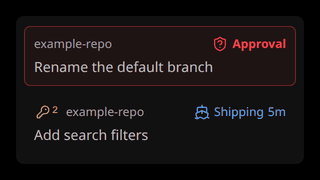
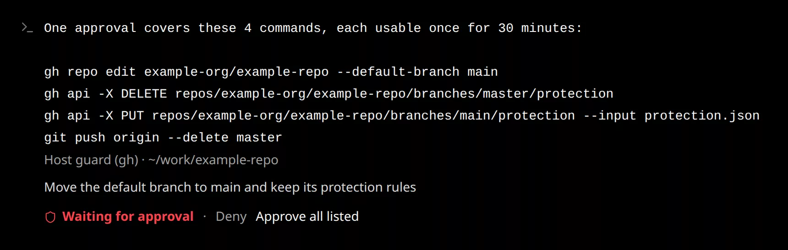
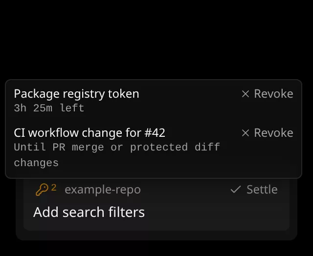
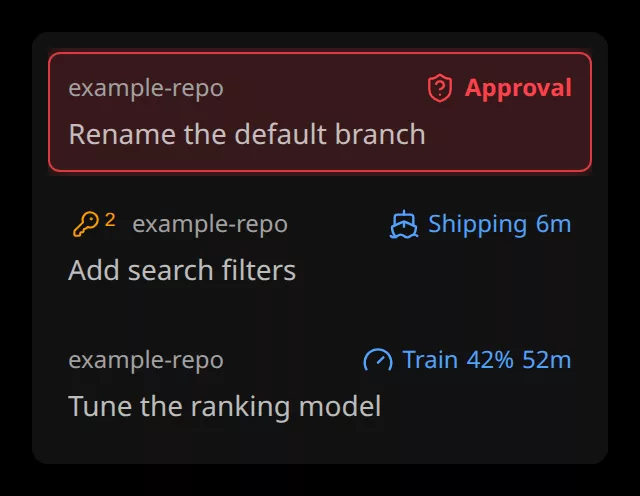
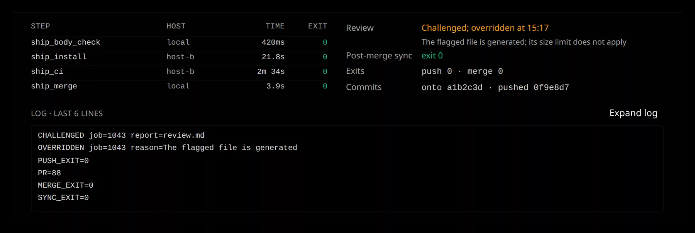
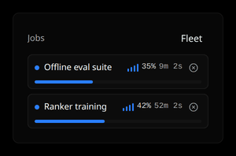
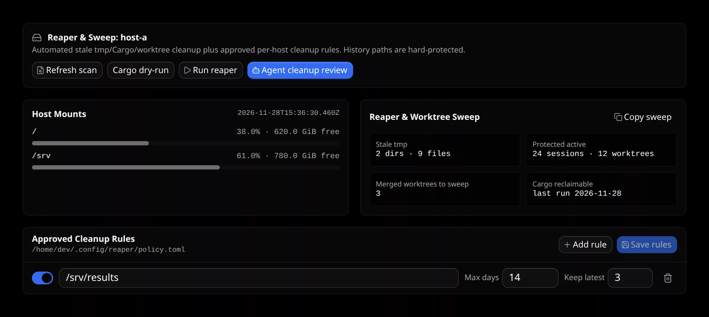
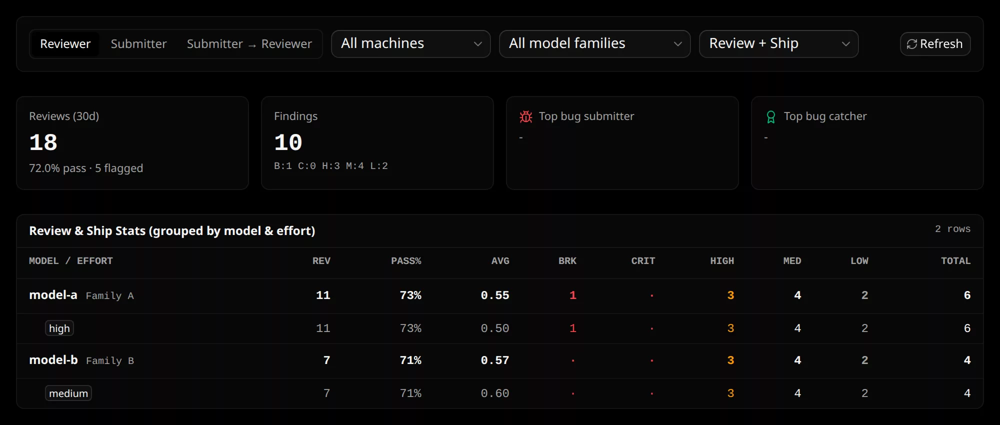

# MarsCode

MarsCode is a fork of [T3 Code](https://github.com/pingdotgg/t3code) for people who run many coding agents at once, across several machines. It adds owner approvals that find you, a merge queue that agents cannot skip, a machine-checked playbook for agent-built repos, and one console for every host and job.

This page covers only what MarsCode adds. For install steps and the base app, see the [T3 Code README](https://github.com/pingdotgg/t3code#readme) and the [docs](./docs/README.md).

- [Approvals that find you](#approvals-that-find-you): a glowing thread, one window for a list of commands, and a key icon for live permissions
- [Ship queue](#ship-queue): agents submit; the queue runs CI, the playbook review, and the merge
- [Agent-ready playbook](#agent-ready-playbook): rules your repo proves with evidence, checked on every merge
- [Public-repo scan](#public-repo-scan): no home paths, host names, or private repo names in public code
- [Jobs in the thread](#jobs-in-the-thread): background jobs with live health bars beside the chat
- [Fleet console](#fleet-console): every host, job, and runaway process in one place
- [Host guards and the Security page](#host-guards-and-the-security-page) · [Reaper](#reaper) · [Reviews](#reviews) · [Smaller additions](#smaller-additions)

## Approvals that find you

When an agent needs your permission, its thread glows in the sidebar until you answer. You see which agent is blocked without opening each thread.



<details>
<summary>How it works</summary>

**The glow.** A thread with a pending approval pulses red in the sidebar and shows an **Approval** status. Host-guard refusals and Ship Queue dependency holds count too, and so does a request from any subagent under the thread. With reduced motion on, the row stays lit and does not pulse.

**One window for a list of commands.** An agent that must run several guarded commands writes them to a plan file and sets `HOST_GUARD_OVERRIDE_PLAN=<file>`. The first refused command asks you once for the whole list. You read every exact command and the agent's reason, then press **Approve all listed** or **Deny**.



- An approval covers only the exact commands in the plan (up to 32), each usable once, for 30 minutes, in the same thread and directory.
- The reason must say why, in words. A plan cannot approve guards that bind to a protected diff, such as the ship queue or the playbook; those need their own approval.
- A single refused command works the same way: the agent runs it again with `HOST_GUARD_OVERRIDE="<why>"`, and you get **Approve once** or **Deny** in the thread.

**The key icon.** A thread that holds a live permission shows a key on its row. Hover it to see each grant and the time left, and revoke one with a click.



MarsCode's built-in agent instructions tell agents to ask through these windows, never to hand you a command to paste.

</details>

## Ship queue

Agents never merge pull requests themselves: they submit a clean worktree, and the queue runs CI on a free host, the playbook review, the PR, the merge, and the post-merge sync. You watch each job move from the sidebar.


<details>
<summary>How it works</summary>

Agents run `ship-queue submit` and `ship-queue watch` (`packages/ship-queue`). The thread sidebar shows **Shipping** or **Deploying** on the thread whose job is in the queue, and the Ship Queue panel lists every job with its repo, CI host, PR, and load.



- **Declared steps.** A repo declares its ship steps (`ship_body_check`, `ship_install`, `ship_ci`, `ship_merge`, `ship_post_merge`). The queue always runs the base branch's declaration, so a branch cannot change how it ships.
- **Per-step timing.** Each step records its host, exit code, and wall time. The job details show them next to the review verdict, the post-merge sync, and the log.

  

- **House gates before CI.** A secret scan (gitleaks, when the host has it), the [public-repo scan](#public-repo-scan), and a check that protected files carry an owner approval.
- **Safe merges.** The PR body must close an issue. The merge is a squash pinned to the commit that passed the gates, and the pass record is keyed by the tree hash. The post-merge sync records its exit, so a crash cannot leave it half done.
- **No retry loops.** After two failures in a row at the same gate, the next submit must state a premise: what the agent thinks is wrong, how it tested that, and the result.


</details>

## Agent-ready playbook

The playbook is a set of rules for repos that many agents build in parallel. A repo declares its rules as contracts and proves each one with evidence from its own checks; missing or stale evidence never counts as a pass.

**Point your agent at [PLAYBOOK.md](./packages/playbook/PLAYBOOK.md).** It is short, and it is written for agents to read and follow.

<details>
<summary>How it works</summary>

`packages/playbook` holds the rules ([PLAYBOOK.md](./packages/playbook/PLAYBOOK.md)) and the `playbook` CLI that checks them. The playbook does not run your checks or scan your code. Your repo's own checks write the evidence; the playbook makes sure that evidence is real, current, and complete.

**Machine-checked contracts** ([§1](./packages/playbook/PLAYBOOK.md#1-contracts-growth--scoped-exceptions)). A repo lists its contracts in `playbook.json`: size, generations, intent, fleet, dictionary, migrations, actions, design, optimization, maps, tools, and docs. `playbook check` reads each contract's evidence receipt and fails or marks it UNPROVEN when:

- the receipt is missing, or was made for a different tree than `HEAD`, or the checkout has uncommitted changes;
- a check has no timing, or an exception is not declared with a reason and an open issue (`#N`);
- a reason is filler such as "needed" or "todo".

There are no baselines. A contract is declared, or opted out with a reason, or it is UNPROVEN. A **ratchet** compares the declaration with the base branch: removing a contract, adding an exception, raising a size limit, or loosening a CI ceiling needs an owner override.

**Declared checks and CI tiers** ([§13](./packages/playbook/PLAYBOOK.md#13-declared-checks--dead-code), [§14](./packages/playbook/PLAYBOOK.md#14-ci-standards-and-execution-tiers)). Every active language needs real lint, typecheck, dependency, and dead-code checks. CI runs in diff-selected tiers: Tier 1 under 60 s, Tier 2 under 3 min, Tier 3 under 5 min. The CI receipt must show the selected suites, setup and test time, and per-step timing; any step over 30 s must break down into sub-steps, so the slow part is visible.

**The adversarial challenge** ([§2.2](./packages/playbook/PLAYBOOK.md#2-ship-queue)). `playbook challenge` has a model review each change strictly against the playbook and cite the section it breaks. It reports code bugs only when they are breaking, critical, or high on a production path. The ship queue runs it after CI. On a **CHALLENGED** verdict the job waits 30 seconds for `ship-queue override <job> --reason "<why>"`, then leaves the queue. An override reason goes into the PR body and is counted in review statistics; otherwise the agent fixes the findings and submits again.

**Size and decomposition** ([§3](./packages/playbook/PLAYBOOK.md#3-file-size-ratchet)). Source files stay at 500 lines or fewer. A split must follow a named domain seam (`*Sql.ts`, `*Wire.ts`, `*Catalog.ts`, `*Types.ts`), never a generic `utils` file, and the size receipt records each split with its seam. Cramming code onto fewer lines to pass is a challenge finding.

**Intent and surface contracts** ([§5](./packages/playbook/PLAYBOOK.md#5-contract-changes)). When a change adds, removes, or modifies an item in a contract (routes, fleet, dictionary, actions, slots), the PR body must say so:

```md
## Contract Intent

- ADD surface GET /api/search (the new search filters need it)
```

CI refuses an undeclared change, and a declared change that did not happen. The `surface` CLI answers which routes exist and who calls them.

**Owner-only changes.** `PLAYBOOK.md` changes only through `playbook amend`, with owner approval. Changes to `playbook.json`, host guards, and CI workflows need an owner grant too.

</details>

## Public-repo scan

A playbook gate that keeps personal details out of public repositories: home paths, host names, private repository names, commit identities, and agent session IDs. Each machine keeps its own denylist of what counts as private, outside the repo, so the rules never leak with the code.

<details>
<summary>How it works</summary>

`packages/hygiene` scans the tracked tree, history, commit metadata, and text that agents post to GitHub through `gh` or MCP tools.

- It runs as git hooks, as a CI step, and as a ship gate, and it writes playbook evidence.
- The denylist lives outside the repo and must be readable by its owner only.
- A finding names the kind of leak and where it is, never the matched text.
- Private repositories skip the gate. A repo with unknown visibility counts as public.
- Agent attribution follows visibility: public repos get a neutral agent name only.
- Exceptions live in `hygiene.exceptions.json`, each with a reason and an issue, and changing them needs an owner grant.

</details>

## Jobs in the thread

Long commands an agent starts show up beside the chat, with progress and a health bar. You see a stalled or hung job before the agent does.


<details>
<summary>How it works</summary>

When an agent runs a long command under `cerno watch` (a log watcher that judges whether a command is progressing), MarsCode turns it into a background job bound to the thread. The thread rail lists each job with a status dot, progress, elapsed time, and cerno's verdict as four bars: the colour is the verdict (for example Healthy, Possibly stalled, Stalled, Failing, Needs input) and the number of lit bars is cerno's confidence. Hover the bars for the label and the evidence. The same rail shows the thread's Ship Queue job, its device leases, and its sessions.



- In the sidebar, the thread shows the job's kind and percent (for example **Train 42%**).
- Stop a job from the rail; a background command asks first, because stopping it stops the thread's turn.
- **Fleet** opens the job in the Fleet console with its load and log.

</details>

## Fleet console

The sailboat icon in the sidebar opens the Fleet console. It shows every host's CPU, memory, GPU, and disk load, and the agent threads, jobs, and hot processes on each one.


<details>
<summary>How it works</summary>


- Select a host to see its threads, background jobs, and hot processes. Stop a job or kill a runaway process from the same view.
- Remote hosts report their processes and jobs too; you close a remote process from its own host.
- Each host shows whether it takes CI jobs, and you can turn that off per host.
- `[` and `]` move between hosts.

</details>

## Host guards and the Security page

Host guards stop agents from merging outside the queue, installing into the wrong place, and changing protected files without your approval. Settings > Security shows every live approval and lets you revoke it.


<details>
<summary>How it works</summary>

- `packages/host-guards` wraps `git`, `gh`, and install commands. A refused command tells the agent how to ask; you answer in the thread.
- An approval for protected files is bound to the exact protected diff. It ends when the PR merges or the diff changes.
- Secret access through the in-app secret request lasts 24 hours and is listed with its thread.
- Every grant, use, and revoke goes to the audit log.

</details>

## Reaper

The Reaper frees disk space on every host without touching anything that holds history. Agents propose cleanup rules; you see what each would delete before you turn it on.



<details>
<summary>How it works</summary>

- It cleans stale temp files, Cargo build output, and merged worktrees, and applies the rules you approve per host.
- An agent cleanup review proposes rules, each with what it deletes and why that is safe. You get a measured preview, and an accepted rule stays off until you turn it on.
- Git data and paths that hold history are protected. An unreadable policy stops the sweep.
- Session archives move to a slower storage tier only after the copy is byte-compared and synced to disk.

</details>

## Reviews

The Reviews panel shows how well each model reviews code: pass rate, flagged reviews, and findings by severity, across all connected hosts.



## Smaller additions

- **Cite button.** The button that quotes selected reply text into the composer has high contrast and a short pop-in, so you notice it.
- **Device leases.** A thread takes an exclusive lease on an Android emulator or iOS simulator. Idle leases expire, so agents do not fight over one device.
- **Secret monitor.** `packages/secret-monitor` watches the desktop Secret Service and links each secret read to the thread that made it.
- **Agent instructions.** One editable instruction text for every provider (Settings > Threads > Advanced).
- **Usage.** Usage history includes archived sessions and a GLM provider.
- **CLIs.** `runlog` runs a test command into a log file and prints a summary. `fleet` and `surface` answer quick questions about declared infrastructure, and about routes and their callers.

<details>
<summary>The Cite button</summary>


</details>

## Contributing

README images are rendered from the real components; see [README media](./docs/internals/readme-media.md).

## License

[MIT](./LICENSE). MarsCode keeps the upstream license.
