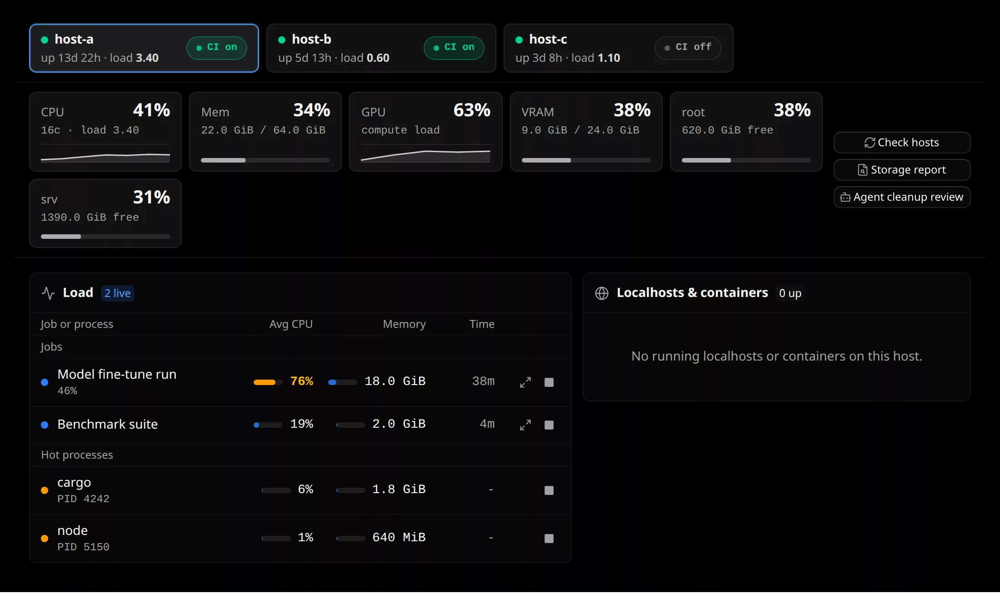
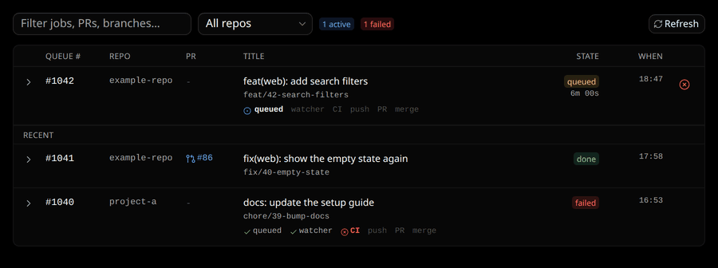
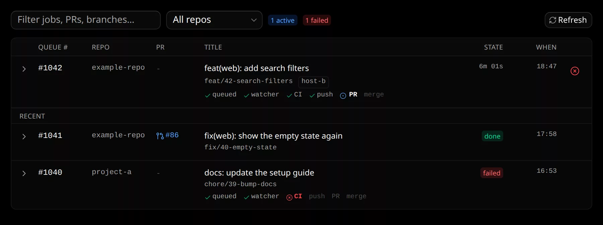
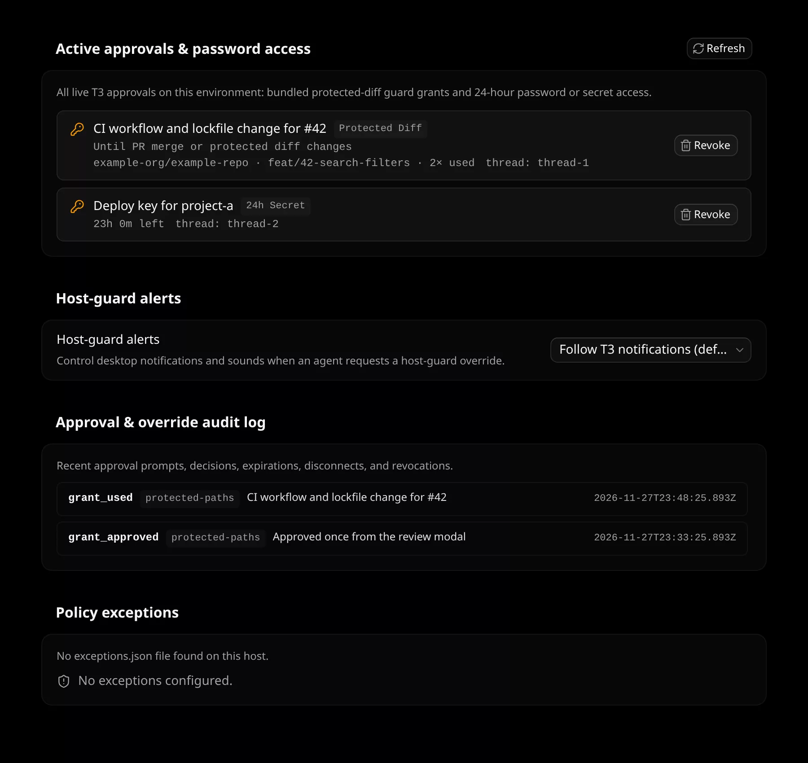
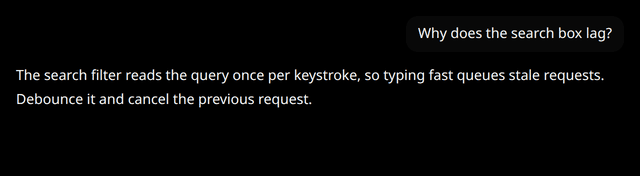

# MarsCode

MarsCode is a fork of [T3 Code](https://github.com/pingdotgg/t3code), the open-source GUI for coding agents. Install steps, providers, remote access, and every base feature are documented upstream: start with the [T3 Code README](https://github.com/pingdotgg/t3code#readme) and the [docs](./docs/README.md). This page covers only what MarsCode adds: tools for running many agents across several machines, and the gates that let their work merge safely.

## What's different

### Fleet console

DevTools shows every host in the fleet with live CPU, memory, GPU, and disk load. For the selected host, it lists the agent threads, background jobs, and hot processes, so you can stop a job or kill a runaway process from one place. Remote hosts report their processes and jobs too; you close remote processes from their own host.

### Ship queue

Agents do not merge pull requests themselves. They submit a clean worktree to the ship queue (`packages/ship-queue`, CLI `ship-queue submit` / `watch`). The queue runs CI on a free CI host, pushes, opens the PR, merges it when the base has not moved, and then runs the repo's post-merge sync. The Jobs and Ship Queue panel shows each job move through those steps.

### Reaper and session-archive tiering

The Reaper cleans stale temp files, Cargo build output, and merged worktrees, and it applies the cleanup rules you approve per host. An Agent cleanup review finds safe cleanup targets and proposes them as rules, each with what it deletes and why that is safe; you accept or reject each one in the Reaper tab. Paths that hold history are protected. Session archives move to a slower storage tier only after the copy is byte-compared and synced to disk.

### Reviews

The Reviews panel counts code reviews by model and effort across all connected hosts: pass rate, flagged reviews, and findings by severity.

### Host guards and the Security page

Host guards (`packages/host-guards`) wrap `git`, `gh`, and install commands. They stop agents from merging outside the queue, installing into the wrong place, and changing protected files without approval. A guarded change asks first: you approve one bundle, bound to the exact protected diff, and the approval ends when the PR merges or the diff changes. Settings > Security lists the live approvals and 24-hour secret access, lets you revoke them, and keeps an audit log.

### Agent-ready playbook

`packages/playbook` holds the [playbook](./packages/playbook/PLAYBOOK.md): rules that a repo declares as contracts in `playbook.json` and proves with evidence from its own checks. `playbook check` validates the evidence. `playbook challenge` runs an LLM reviewer against the playbook before a merge.

### Public-repo hygiene

`packages/hygiene` keeps private details out of public repositories. It scans the tree, staged changes, and commit messages through git hooks and the ship gate. A guard checks text that agents post to GitHub through `gh` or MCP tools. Agent attribution on commits and PRs follows the repository's visibility.

### Cite button

Select text in an agent's reply and a **Cite** button appears. It quotes the selection into the composer. MarsCode gives the button high contrast and a short pop-in, so it is easy to see.

### Smaller additions

- **Device leases.** A thread takes an exclusive lease on an Android emulator or iOS simulator. Idle leases expire and are swept, so agents do not fight over one device.
- **Secret monitor.** `packages/secret-monitor` watches the desktop Secret Service bus and links each secret read to the T3 thread that made it.
- **Usage.** Usage history includes archived sessions and a GLM provider.
- **CLIs.** `runlog` runs a test command into a log file and prints a summary. `fleet` and `surface` answer fast questions about declared infrastructure and about routes and their callers.

## Keeping this README current

The images come from the real web components with neutral fixtures (`apps/web/test/readme`), never from a live app. `docs/readme/media.json` maps each image to the source files it shows and stores their hash.

- `vp run readme:media` renders all images again and updates the hashes. It needs `ffmpeg` and an installed Playwright Chromium headless shell; it does not download one.
- `vp run readme:media --check` fails when a mapped source changed after its image was made. The ship gate runs this check.

When you add a feature, add its block here, and add an image only when a screenshot explains it better than a sentence. Look at every new image before you commit it: this repository is public.

## License

[MIT](./LICENSE). MarsCode keeps the upstream license.
